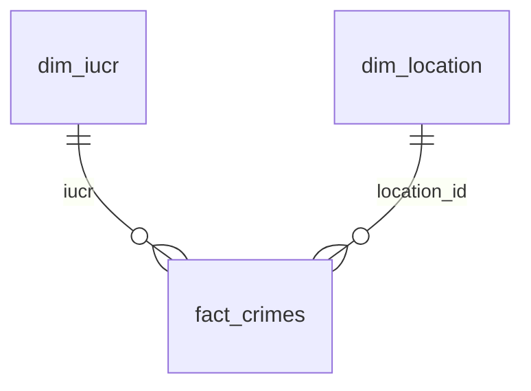

# Phase 3 Notes

## Cleaning rules (before/after)
| Rule | Rows |
|---|---|
| Raw rows | 230,425 |
| Dropped: missing case_number / date / iucr / primary description | 0 |
| Dropped: future dates | 0 |
| Dropped: duplicates on (case_number, crime_date, iucr) | 1 |
| ward = 0 (valid is 1-50) set to NULL, row kept | 398 |
| Clean rows | 230,424 |

Other rules: trim + uppercase strings, empty location -> 'UNKNOWN', date parsed to timestamp,
Y/N -> boolean, beat/ward -> integer. 457 rows have no coordinates and are kept as NULL (under the 5% threshold).
Dropped redundant columns: X COORDINATE, Y COORDINATE, LOCATION. The raw table is never modified.

## Schema

- dim_iucr(iucr PK, primary_description, secondary_description)
- dim_location(location_id PK, location_description UNIQUE)
- fact_crimes(crime_id PK, iucr FK, location_id FK, UNIQUE(case_number, crime_date, iucr), ...)

CASE# is not unique (one case can have several rows), so fact_crimes uses a surrogate PK.

## JOINs
The views join fact_crimes with the dimension tables to show crime type and location names.

## Views
- v_crimes_by_type -> (اكتب سؤال 1)
- v_arrest_rate_by_type -> (اكتب سؤال 2)
- v_crimes_by_location -> (اكتب سؤال 3)